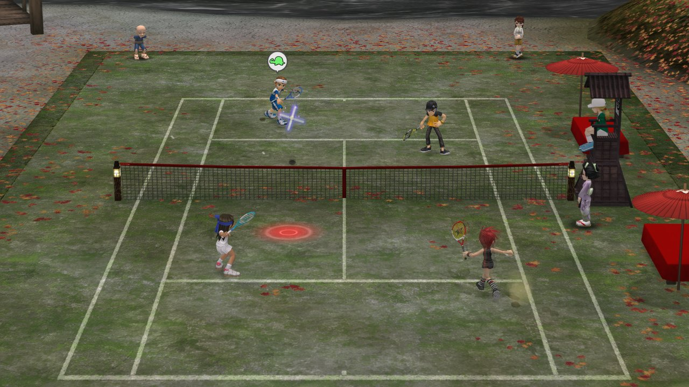
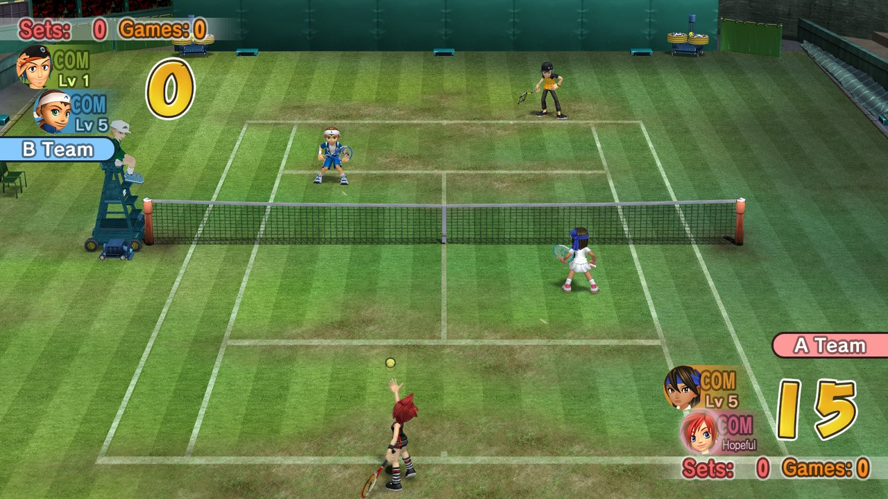
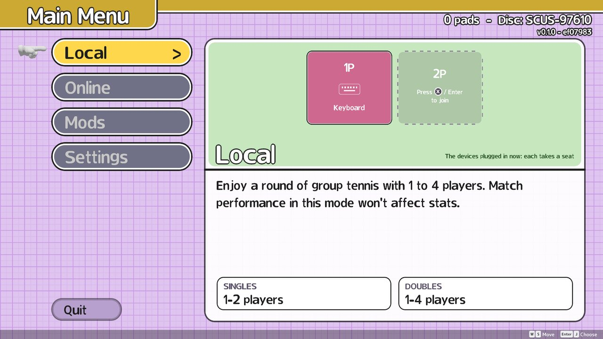
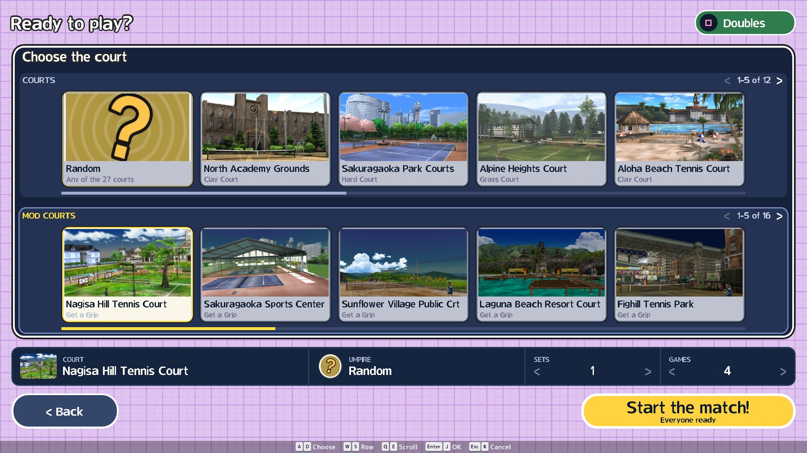
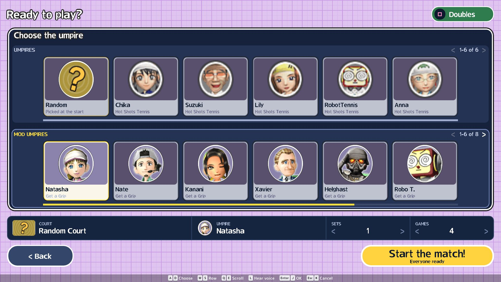

# OpenTennis — a remaster of Hot Shots Tennis (PS2)

A from-scratch rewrite of the PlayStation 2 game **Hot Shots Tennis** (US, 2007), known as **Everybody's Tennis**
in Europe and **Minna no Tennis** (みんなのテニス) in Japan, in Rust with the [Bevy](https://bevyengine.org) engine.
The goal is the same game: the same ball physics, rules, timing and AI, ported from the original and checked
frame by frame against the real game, with better rendering on top.

**Play in your browser: <https://opentennis.dev>** (you pick your own ISO; nothing is uploaded).

Newest unreleased build (every change to main, less tested): <https://beta.opentennis.dev>.

**Download** for Windows, Linux, Android or iOS: [latest release](https://github.com/FIZL0/opentennis/releases/latest).

Work in progress. Building from source, modding by hand and development: [docs/DEVELOPING.md](docs/DEVELOPING.md).

## Screenshots

Taken from the remaster running on a retail disc (the art comes from the disc; none of it is in this repository).

| | |
|---|---|
|  |  |
|  |  |
|  |  |
|  |  |
|  | |

## You must provide the game disc

**This repository contains no game data**: no models, textures, animations, sounds, music or program code from the
original. Everything the game shows or plays is read **at runtime from your own copy of the disc**. Without it,
nothing runs.

What you need:

| | |
|---|---|
| **Disc** | Hot Shots Tennis, **US release, version 1.00, serial SCUS-97610** (PS2) |
| **Format** | A disc image (`.iso`) you made from **a disc you own** |
| **Where** | Anywhere; the game asks for it the first time (the browser keeps it in private storage, nothing is uploaded) |

- **Other regions don't work.** Everybody's Tennis (Europe), Minna no Tennis (Japan) and other versions have
  different program data. The game checks the disc (`SYSTEM.CNF` boot file `SCUS_976.10` and the size and header of
  `ZZBIN/GAME.BIN`) and refuses anything else with `unsupported disc`.
- **Don't ask for, share or commit disc images or anything extracted from them.** Nobody here can provide one.
- **You don't need a PS2 BIOS, an emulator or any other files** to play. Those are only for the research tools
  (see [docs/DEVELOPING.md](docs/DEVELOPING.md)).

## Controls

Player 1 uses the keyboard or the first controller. In doubles, a second controller plays player 1's partner (P1 + P2
vs 2 CPUs); in singles it plays the opponent. Every other player is a CPU.

| Action | Keyboard | Controller |
|---|---|---|
| Move (aim while swinging) | WASD | Left stick / d-pad |
| Topspin | J | A |
| Slice / Serve | K | B |
| Lob | L | Y |
| Drive | U | RB |
| Swap hand (character select) | C | Select |

## Mods

Main menu → Mods adds characters, courts and umpires from the store
([`FIZL0/opentennis-mods`](https://huggingface.co/datasets/FIZL0/opentennis-mods)), on desktop and in the browser.

- **Browse mods**: pick one to install it.
- **Upload my mod**: sign in with a Hugging Face *Write* token, then pick a mod to upload. It shows as
  *Not reviewed* until merged.
- **Made your own?** Put its folder (`mod.json` + `.glb` files) in `mods/<id>/` beside the ISO; it shows in the
  game and in Upload my mod. How to make one: [opentennis-mods](https://github.com/FIZL0/opentennis-mods).

Texture replacements: texture packs (a mod whose `mod.json` says `"kind": "textures"`; several stack in an order) and
`mods/texture-replacements/` replace the disc's textures, a PCSX2 texture pack made for the original game works as is, and
mods can carry upscaled textures of their own (the "Texture Replacements" setting). How to make either: [docs/DEVELOPING.md](docs/DEVELOPING.md).

## Online play

Main menu → Online.

- **Host**, **Find**, **Quick play**, or **Join** with a code or the host's QR.
- Open seats are played by the computer.
- Browser and desktop players can play together (Find is desktop only).
- No internet? Set Relay to Off on the same network (LAN, or browsers via QR).

More (own relay, settings file): [docs/DEVELOPING.md](docs/DEVELOPING.md).

## License

The code is licensed under either of [Apache License 2.0](LICENSE-APACHE) or [MIT](LICENSE-MIT), at your option.
This covers the code only, not the game or its data.

## Legal

This is an unofficial fan project, not affiliated with or endorsed by Sony Interactive Entertainment or Clap
Hanz. Hot Shots Tennis, Everybody's Tennis and Minna no Tennis are trademarks of their owners. No copyrighted game
data is included or distributed. You must own the game to use this.
